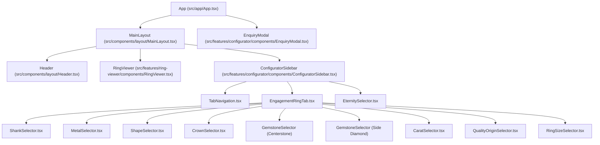

# Component Architecture & UI Hierarchy Guide

This guide details the React component structure, props specifications, state lifecycle, and event delegation patterns in the **Alloyum 3D Ring Configurator**.

---

## 1. Component Hierarchy Diagram



---

## 2. Layout Components

### 2.1 `MainLayout.tsx`
- **Location:** [`src/components/layout/MainLayout.tsx`](file:///C:/Users/admin/Downloads/3d-jewelry/src/components/layout/MainLayout.tsx)
- **Role:** High-level flex layout orchestrator. Manages header visibility based on fullscreen state and handles the 70%/30% desktop split and 50%/50% mobile stacked arrangement.
- **Props:**
  ```typescript
  interface MainLayoutProps {
    isFullscreen?: boolean;
    children: ReactNode;
  }
  ```

### 2.2 `Header.tsx`
- **Location:** [`src/components/layout/Header.tsx`](file:///C:/Users/admin/Downloads/3d-jewelry/src/components/layout/Header.tsx)
- **Role:** Sticky top navigation bar containing the Alloyum brand icon, name, and a "Sign in" call-to-action button. Automatically unmounted when the user enters fullscreen 3D mode.

---

## 3. 3D Ring Viewer Component

### 3.1 `RingViewer.tsx`
- **Location:** [`src/features/ring-viewer/components/RingViewer.tsx`](file:///C:/Users/admin/Downloads/3d-jewelry/src/features/ring-viewer/components/RingViewer.tsx)
- **Role:** Viewport host for the Three.js WebGL canvas. Renders branding watermarks, rotational touch gesture hints, loading spinners, and the fullscreen toggle button.
- **Props:**
  ```typescript
  interface RingViewerProps {
    state: ConfiguratorState;
    onToggleFullscreen: () => void;
  }
  ```
- **Internal Hook:** Delegates all Three.js setup, model loading, render looping, and WebGL lifecycle to [`useRingViewer`](file:///C:/Users/admin/Downloads/3d-jewelry/src/features/ring-viewer/hooks/useRingViewer.ts).

---

## 4. Configurator Feature Components

### 4.1 `ConfiguratorSidebar.tsx`
- **Location:** [`src/features/configurator/components/ConfiguratorSidebar.tsx`](file:///C:/Users/admin/Downloads/3d-jewelry/src/features/configurator/components/ConfiguratorSidebar.tsx)
- **Role:** Master sidebar container. Displays title, description, dynamic price, animated loading bar, tab switcher, active tab controls, and the sticky "INTERESTED, ENQUIRE?" CTA button.
- **Props:**
  ```typescript
  interface ConfiguratorSidebarProps {
    state: ConfiguratorState;
    updateState: (updates: Partial<ConfiguratorState>) => void;
    onOpenEnquiry: () => void;
  }
  ```

### 4.2 `TabNavigation.tsx`
- **Location:** [`src/features/configurator/components/TabNavigation.tsx`](file:///C:/Users/admin/Downloads/3d-jewelry/src/features/configurator/components/TabNavigation.tsx)
- **Role:** Switches between **Engagement Ring** and **Eternity Ring** configuration modes. Features an underline active indicator matching the reference design.
- **Props:**
  ```typescript
  interface TabNavigationProps {
    activeTab: 'engagement' | 'eternity';
    onTabChange: (tab: 'engagement' | 'eternity') => void;
  }
  ```

### 4.3 `EngagementRingTab.tsx`
- **Location:** [`src/features/configurator/components/EngagementRingTab.tsx`](file:///C:/Users/admin/Downloads/3d-jewelry/src/features/configurator/components/EngagementRingTab.tsx)
- **Role:** Composes all 8 selector controls for the engagement ring in an orderly vertical scroll container.

### 4.4 Granular Selector Controls

| Component | Responsibility | Props |
| :--- | :--- | :--- |
| **`ShankSelector.tsx`** | Renders horizontal/wrapped thumbnail list of shank band designs (`SH PV 1`, `SH 3 PV Y`, etc.) | `options: ShankOption[]`, `selected: ShankOption`, `onSelect: (shank) => void` |
| **`MetalSelector.tsx`** | Renders 18k White Gold, Yellow Gold, Rose Gold, and Platinum circular swatches with active ring border | `options: MetalOption[]`, `selected: MetalOption`, `onSelect: (metal) => void` |
| **`ShapeSelector.tsx`** | Renders gemstone cut silhouettes (Round, Cushion, Oval, Pear, etc.) with active underline | `options: ShapeOption[]`, `selected: ShapeOption`, `onSelect: (shape) => void` |
| **`CrownSelector.tsx`** | Renders crown/head setting wireframe icons (Hidden Halo, Solitaire, etc.) with active underline | `options: CrownOption[]`, `selected: CrownOption`, `onSelect: (crown) => void` |
| **`GemstoneSelector.tsx`** | Generic gemstone palette used for both Centerstone and Side Pavé Diamonds | `label: string`, `options: GemstoneOption[]`, `selected: GemstoneOption`, `onSelect: (gem) => void` |
| **`CaratSelector.tsx`** | Carat weight buttons (`0.50 ct` to `3.00 ct`) triggering dynamic 3D scale transforms | `options: CaratOption[]`, `selected: CaratOption`, `onSelect: (carat) => void` |
| **`QualityOriginSelector.tsx`** | Segmented pill toggles for **Quality** (`Good` vs `Ideal`) and **Diamond Origin** (`Natural` vs `Lab-Grown`) | `quality: Quality`, `origin: Origin`, `onQualityChange: (q) => void`, `onOriginChange: (o) => void` |
| **`RingSizeSelector.tsx`** | Dropdown picker for US ring sizes (`US 4` to `US 12` in half-size increments) | `selected: string`, `onSelect: (size: string) => void` |
| **`EternitySelector.tsx`** | Stackable band controls with `NO ETERNITY` / `ADD ETERNITY` pill toggle and band thumbnail gallery | `state: ConfiguratorState`, `onToggleEternity: (active) => void`, `onSelectEternity: (band) => void` |
| **`EnquiryModal.tsx`** | Full-screen backdrop dialog with inquiry form inputs (name, email, phone, notes, mock reCAPTCHA) | `isOpen: boolean`, `onClose: () => void` |

---

## 5. Event Propagation & Separation of Responsibilities

1. **Pure Presentation Components:** Selectors (`MetalSelector`, `CaratSelector`, etc.) contain zero business logic or pricing formulas. They receive current values and fire granular `onSelect(item)` callbacks.
2. **Batch State Updates:** `useConfigurator` handles partial state updates, dispatches loading bar animations, and ensures immutability.
3. **Decoupled 3D Bridge:** The 3D viewer does not listen to click events from DOM buttons; it observes changes to `state.selectedMetal`, `state.selectedCenterstone`, and `state.selectedCarat` via React `useEffect` hooks, keeping WebGL and DOM logic entirely decoupled.
