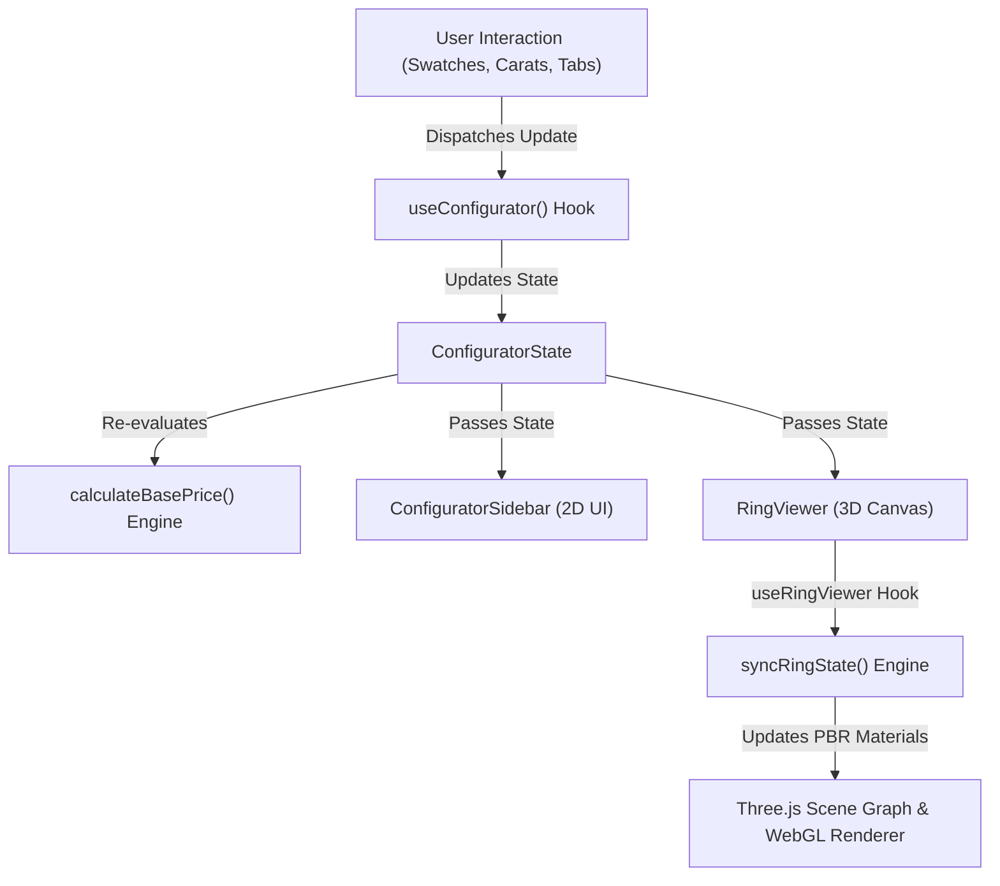

# Alloyum 3D Ring Configurator — Technical Stack & Codebase Guide

This document is a comprehensive developer manual for the **Alloyum 3D Ring Configurator**. It covers the architecture, technology stack, directory structure, state flow, pricing formulas, 3D asset pipeline, QA testing methodology, and practical modification recipes.

---

## 1. Executive Summary & Forensic Tech Stack

### 1.1 The Actual Technology Stack
Contrary to external appearances or documentation from other configurator products, this codebase uses **Standard Three.js directly within a React 18 + Vite application**.

| Layer | Technology | Version | Actual Role in Codebase |
| :--- | :--- | :--- | :--- |
| **UI Framework** | React | `^18.3.1` | Component lifecycle, declarative UI hierarchy, options state |
| **Language** | TypeScript | `^5.6.2` | Strong static typing for configurations, options, and 3D hooks |
| **Bundler / Tooling** | Vite | `^6.2.0` | Ultra-fast HMR, ES module bundling, static asset serving |
| **Styling** | Tailwind CSS | `^3.4.17` | Utility-first responsive styling matching reference design |
| **3D Engine** | Three.js (`three`) | `^0.174.0` | WebGL rendering, scene graph, cameras, lighting, materials |
| **3D Controls** | OrbitControls (`three/examples`) | Bundled | Smooth damped orbit, pan, pitch clamping |
| **Model Loader** | GLTFLoader (`three/examples`) | Bundled | Asynchronous loading of `.glb` binary geometry scenes |
| **Mesh Compression** | DRACOLoader (`three/examples`) | Bundled | WebAssembly decoding for DRACO-compressed ring CAD meshes |
| **Environment** | PMREMGenerator (`three`) | Bundled | Prefiltered Equirectangular Radiance Environment Maps |
| **Testing / QA** | Playwright Core | `^1.56.0` | Headless/CDP browser automation via **Brave Browser** |

### 1.2 Technology Stack Clarification: What Is NOT Used
- **Threepipe (`threepipe`) is NOT used**: The application directly manages the Three.js `WebGLRenderer`, `PerspectiveCamera`, `Scene`, and animation loop inside a clean React custom hook.
- **React Three Fiber (`@react-three/fiber`) is NOT used**: Three.js primitives are not wrapped in JSX canvas elements; this provides direct, fine-grained control over WebGL garbage collection, shader uniforms, and render loops without additional abstraction overhead.
- **Drei (`@react-three/drei`) is NOT used**: All orbit controls, loaders, and environment generators are standard Three.js JSM modules.

---

## 2. Target Project Architecture & Directory Layout

The codebase has been refactored into a **feature-oriented architecture** that enforces strict separation of concerns between 2D UI controls and 3D WebGL rendering.

```text
3d-jewelry/
├── public/
│   ├── assets/
│   │   ├── logo.png                   # Watermark & navigation logo
│   │   ├── models/                    # DRACO-compressed GLB CAD models
│   │   │   ├── sh_pave_1.glb          # Engagement ring shank with pavé
│   │   │   ├── hd_oval_10.glb         # Ring head / crown with oval diamond
│   │   │   └── et_plain_03.glb        # Stackable wedding / eternity band
│   │   └── thumbnails/                # 2D preview swatches (PNG/SVG)
│   │       ├── crowns/                # Crown style previews
│   │       ├── eternity/              # Stackable band previews
│   │       ├── metals/                # Metal swatches (white/yellow/rose)
│   │       ├── shapes/                # Gemstone cut silhouettes
│   │       └── shanks/                # Shank band variations
│   └── draco/
│       └── gltf/                      # DRACO WebAssembly decoders (draco_decoder.wasm)
│
├── src/
│   ├── app/
│   │   └── App.tsx                    # Top-level composition and layout assembly
│   │
│   ├── components/
│   │   └── layout/
│   │       ├── Header.tsx             # Top navigation bar (logo, links, sign in)
│   │       └── MainLayout.tsx         # Responsive desktop/mobile viewport layout
│   │
│   ├── features/
│   │   ├── configurator/              # Configurator feature module
│   │   │   ├── components/            # UI selector controls
│   │   │   │   ├── ConfiguratorSidebar.tsx  # Main right-hand control container
│   │   │   │   ├── TabNavigation.tsx        # Engagement / Eternity switcher
│   │   │   │   ├── EngagementRingTab.tsx    # Engagement controls collection
│   │   │   │   ├── ShankSelector.tsx        # Shank thumbnail picker
│   │   │   │   ├── MetalSelector.tsx        # Metal swatches (18k Gold/Platinum)
│   │   │   │   ├── ShapeSelector.tsx        # Diamond shape cut selector
│   │   │   │   ├── CrownSelector.tsx        # Crown/head setting selector
│   │   │   │   ├── GemstoneSelector.tsx     # Centerstone & side gem selectors
│   │   │   │   ├── CaratSelector.tsx        # Carat weight buttons (0.50 - 3.00 ct)
│   │   │   │   ├── QualityOriginSelector.tsx# Lab/Natural & Good/Ideal selectors
│   │   │   │   ├── RingSizeSelector.tsx     # US 4 - US 12 ring size dropdown
│   │   │   │   ├── EternitySelector.tsx     # Eternity tab toggle & band picker
│   │   │   │   └── EnquiryModal.tsx         # Lead generation form modal
│   │   │   ├── data/
│   │   │   │   └── configuration-options.ts # Static configuration catalogue
│   │   │   ├── hooks/
│   │   │   │   └── useConfigurator.ts       # Configurator state & transition hook
│   │   │   ├── lib/
│   │   │   │   └── pricing.ts               # Dynamic pricing engine
│   │   │   └── types/
│   │   │       └── configurator.types.ts    # TypeScript definitions
│   │   │
│   │   └── ring-viewer/               # 3D WebGL Ring Viewer feature module
│   │       ├── components/
│   │       │   └── RingViewer.tsx           # Canvas container, logo, gestures, toggles
│   │       ├── hooks/
│   │       │   └── useRingViewer.ts         # Three.js lifecycle, loop, resize hook
│   │       ├── lib/
│   │       │   ├── viewer-setup.ts          # Scene, camera, lights, studio PMREM
│   │       │   ├── model-loader.ts          # DRACO GLTF asset loading & caching
│   │       │   ├── ring-materials.ts        # PBR precious metal materials
│   │       │   ├── gemstone-materials.ts    # Physically accurate diamond/gem PBR
│   │       │   └── model-configuration.ts   # Mesh role tagging & carat transforms
│   │       └── types/
│   │           └── viewer.types.ts          # 3D scene & role interfaces
│   │
│   ├── styles/
│   │   └── index.css                  # Tailwind directives and custom scrollbars
│   ├── main.tsx                       # React DOM entry point
│   └── vite-env.d.ts                  # Vite client type definitions
│
├── docs/                              # Architecture and developer documentation
├── post-refactor-screenshots/         # Verified visual regression screenshots
├── baseline-screenshots/              # Historical pre-refactor visual baselines
└── package.json
```

---

## 3. State Management & Data Flow

### 3.1 Unidirectional State Flow
The application follows a clean unidirectional data flow:



### 3.2 `useConfigurator` Hook
Defined in [`src/features/configurator/hooks/useConfigurator.ts`](file:///C:/Users/admin/Downloads/3d-jewelry/src/features/configurator/hooks/useConfigurator.ts), this hook encapsulates:
- Active tab selection (`engagement` vs `eternity`)
- Selected shank, metal, shape, crown, gemstone, carat, quality, origin, ring size
- Eternity band stack toggle and selected eternity band
- Fullscreen mode toggle
- Inquiry modal open/close toggle
- Loading bar state trigger on selection changes

### 3.3 `useRingViewer` Hook
Defined in [`src/features/ring-viewer/hooks/useRingViewer.ts`](file:///C:/Users/admin/Downloads/3d-jewelry/src/features/ring-viewer/hooks/useRingViewer.ts), this hook isolates all imperative WebGL operations from React rendering:
- Mounts and sizes the Three.js canvas
- Creates cameras, directional lights, studio PMREM environment, and contact shadow plane
- Asynchronously loads and instantiates DRACO models
- Automatically synchronizes metal shaders, gemstone shaders, and carat scale on state changes
- Automatically adapts camera distance and aspect ratio on window resize
- Disposes geometries, materials, PMREM generators, and event listeners on unmount to prevent WebGL memory leaks

---

## 4. Dynamic Pricing Calculation Engine

Defined in [`src/features/configurator/lib/pricing.ts`](file:///C:/Users/admin/Downloads/3d-jewelry/src/features/configurator/lib/pricing.ts), the pricing engine computes ring prices dynamically:

### Formula:
$$\text{Price} = (\text{BASE\_RING\_PRICE} + \Delta_{\text{metal}} + \Delta_{\text{carat}}) \times M_{\text{quality}} \times M_{\text{origin}} + (\Delta_{\text{eternity}} \text{ if eternity active})$$

Where:
- $\text{BASE\_RING\_PRICE} = \$2,450$
- $\Delta_{\text{metal}}$:
  - 18k White Gold: $+\$0$ (Default baseline)
  - 18k Yellow Gold: $-\$5$ (Market delta)
  - 18k Rose Gold: $-\$5$
  - Platinum 950: $+\$420$
- $\Delta_{\text{carat}}$:
  - 0.50 ct: $-\$1,100$
  - 1.00 ct: $+\$0$ (Baseline 1.00 ct)
  - 1.50 ct: $+\$1,850$
  - 2.00 ct: $+\$4,200$
  - 3.00 ct: $+\$9,600$
- Multipliers:
  - Natural Origin: $1.0\times$ | Lab-Grown Origin: $0.42\times$
  - Good Quality: $1.0\times$ | Ideal Quality: $1.15\times$
- $\Delta_{\text{eternity}}$: Active eternity band delta (e.g. $+\$195$ for ET-Plain-03)

---

## 5. Responsive Layout & Viewport Specifications

| Viewport Tier | Width × Height | Viewer Dimension | Sidebar Dimension | Behavior |
| :--- | :--- | :--- | :--- | :--- |
| **Desktop** | $1440 \times 900$ | $70\%$ width, $100\%$ height | $30\%$ width, $100\%$ height | Side-by-side split, independent custom scrollbar on sidebar |
| **Laptop** | $1280 \times 800$ | $70\%$ width, $100\%$ height | $30\%$ width, $100\%$ height | Side-by-side split |
| **Tablet** | $768 \times 1024$ | $50\%$ height, $100\%$ width | $50\%$ height, $100\%$ width | Vertically stacked, camera distance adapts automatically |
| **Mobile** | $390 \times 844$ | $50\%$ height, $100\%$ width | $50\%$ height, $100\%$ width | Vertically stacked, touch gestures enabled, sticky CTA |
| **Narrow Mobile** | $360 \times 800$ | $50\%$ height, $100\%$ width | $50\%$ height, $100\%$ width | Compact font sizing, scrollable options |

---

## 6. Practical Developer Modification Recipes

### Recipe 1: How to Add a New Metal (e.g., Black Ruthenium)
1. Open [`src/features/configurator/data/configuration-options.ts`](file:///C:/Users/admin/Downloads/3d-jewelry/src/features/configurator/data/configuration-options.ts).
2. Append a new entry to `METAL_OPTIONS`:
   ```typescript
   {
     id: 'black-ruthenium',
     name: 'Black Ruthenium',
     colorHex: '#2b2b2e',
     roughness: 0.12,
     thumbnail: '/assets/thumbnails/metals/black_ruthenium.png',
     priceDelta: 250,
   }
   ```
3. The UI will automatically render the new swatch and recalculate prices.

### Recipe 2: How to Add a New Colored Gemstone (e.g., Amethyst)
1. Open [`src/features/configurator/data/configuration-options.ts`](file:///C:/Users/admin/Downloads/3d-jewelry/src/features/configurator/data/configuration-options.ts).
2. Append to `GEMSTONE_OPTIONS`:
   ```typescript
   {
     id: 'amethyst',
     name: 'Amethyst',
     colorHex: '#8b5cf6',
     transmissionColor: '#7c3aed',
     ior: 1.544,
   }
   ```
3. In [`src/features/ring-viewer/lib/gemstone-materials.ts`](file:///C:/Users/admin/Downloads/3d-jewelry/src/features/ring-viewer/lib/gemstone-materials.ts), the PBR material factory will automatically use the gemstone's transmission color, attenuation, and IOR to shade the centerstone.

### Recipe 3: How to Adjust Diamond Sparkle and Fire
Open [`src/features/ring-viewer/lib/gemstone-materials.ts`](file:///C:/Users/admin/Downloads/3d-jewelry/src/features/ring-viewer/lib/gemstone-materials.ts) and modify:
- `transmission`: Lower to `0.88` for slightly more internal reflection contrast, or increase to `0.96` for crystal clarity.
- `dispersion`: Increase from `0.044` to `0.060` for more pronounced rainbow flashes.
- `envMapIntensity`: Adjust between `3.5` and `6.0` to balance highlight brightness against room lighting.

---

## 7. Quality Assurance & Testing in Brave Browser

Because the testing environment is strictly **Windows + Brave Browser**, tests attach to the active Brave CDP session or launch the installed Brave binary:
```javascript
const browser = await chromium.launch({
  executablePath: 'C:\\Program Files\\BraveSoftware\\Brave-Browser\\Application\\brave.exe',
  headless: true,
});
```

To run the automated visual regression suite:
```powershell
node verify-post-refactor.cjs
```
This tests all 5 viewports, metal swatches, carat changes, eternity stacking, and modals, capturing verified screenshots to `post-refactor-screenshots/`.
