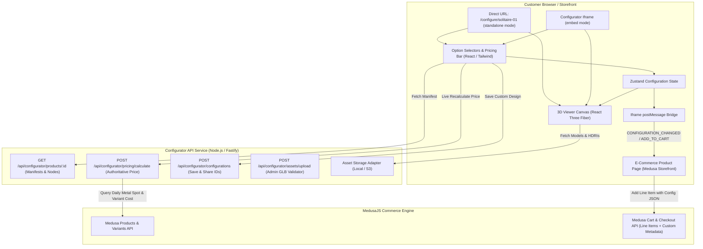

# 02 - System Architecture Specification

## 1. Monorepo Structure and Responsibilities

The production 3D jewellery configurator is structured as a typed monorepo separating shared contracts, backend business logic, and frontend rendering surfaces:

```text
D:/3D-app/
├── apps/
│   └── configurator/               # Standalone & embeddable 3D React Three Fiber frontend
│       ├── public/                 # Static 3D models, HDRIs, and UI icons
│       │   ├── models/             # Solitaire, Halo, and custom uploaded GLBs
│       │   └── environments/       # Studio equirectangular HDR panoramas
│       ├── src/
│       │   ├── app/                # Route wrappers and shell layouts
│       │   ├── features/
│       │   │   ├── configurator/   # Configuration UI controls, swatches, pricing bars
│       │   │   └── product-viewer/ # 3D Canvas, OrbitControls, lighting rigs
│       │   ├── renderer/
│       │   │   ├── core/           # SceneManager, AssetLoader, RendererProvider
│       │   │   ├── materials/      # MaterialRegistry, DiamondFactory, MetalFactory
│       │   │   └── shaders/        # Custom GLSL shaders (diamond refraction, normal capture)
│       │   ├── store/              # Zustand reactive configuration state
│       │   ├── messenger/          # Iframe postMessage bridge for parent storefronts
│       │   └── types/              # Frontend UI types
│       ├── package.json
│       ├── vite.config.ts
│       └── Dockerfile
├── services/
│   └── configurator-api/           # Headless Node.js / Fastify backend service
│       ├── src/
│       │   ├── routes/             # Products, Configurations, Pricing, Asset uploads
│       │   ├── services/           # Authoritative pricing calculator, GLB validator
│       │   ├── storage/            # Local disk / S3 asset storage adapter
│       │   ├── medusa/             # MedusaJS commerce cart & variant adapter
│       │   └── index.ts            # Fastify server entry point
│       ├── package.json
│       ├── tsconfig.json
│       └── Dockerfile
├── packages/
│   └── configurator-contracts/     # Shared Zod schemas, TypeScript types, and interfaces
│       ├── src/
│       │   ├── schemas/            # ConfigurationSchema, ProductManifestSchema
│       │   ├── types/              # MetalType, StoneShape, CaratWeight, Pricing
│       │   └── index.ts
│       └── package.json
├── docker-compose.yml              # Local orchestration (frontend, API, persistent storage)
├── docs/                           # Architectural, reverse-engineering, and user guides
└── Crystal-Jewels/                 # Legacy WebGI prototype (preserved reference)
```

---

## 2. End-to-End System Data Flow



---

## 3. Frontend Architecture (`apps/configurator`)

### 3.1 Technology Stack
- **Framework**: React 18 + TypeScript + Vite.
- **3D Engine**: Three.js (r160+) + `@react-three/fiber` + `@react-three/drei`.
- **Styling**: Tailwind CSS + Lucide Icons.
- **State Management**: **Zustand** with bidirectional URL synchronization.

### 3.2 Key Architectural Subsystems:
1. **SceneManager**: Manages camera framing, dynamic aspect ratio adjustment, and progressive antialiasing.
2. **AssetLoader**: Centralizes GLB and HDRI fetching with in-memory caching, preventing duplicate network requests and managing abort signals on rapid selection.
3. **MaterialRegistry**: Maps typed material identifiers (`metal.pbr.v1`, `diamond.refraction.v1`) to material factories, ensuring shader compilation happens once and instances are shared across matching components.
4. **IframeMessenger**: Implements secure cross-origin communication between the embedded viewer and the parent storefront.

---

## 4. Backend Architecture (`services/configurator-api`)

### 4.1 Technology Stack
- **Runtime**: Node.js v20+ with TypeScript.
- **HTTP Framework**: **Fastify** (chosen for high throughput, low latency, and native JSON schema serialization).
- **Validation**: **Zod** (via `@configurator/contracts`).
- **Storage**: Multi-target storage abstraction supporting local file systems and S3-compatible object stores (MinIO / AWS S3).

### 4.2 Core Services:
1. **Product Manifest Service**: Serves product models, component definitions, supported metals, and allowable stone cuts.
2. **Pricing Engine**: Authoritative server-side calculation of product cost:
   $$\text{Price} = (\text{MetalWeightGrams} \times \text{SpotPricePerGram}) + \text{SettingLabor} + \text{DiamondCaratCost}$$
3. **Asset Registration & Validation Service**: Inspects uploaded GLBs, validates bounding boxes, ensures geometry budgets, and maps mesh nodes to component slots.
4. **MedusaJS Cart Adapter**: Translates a 3D configuration payload into a valid MedusaJS cart line item with snapshot thumbnails and manufacturing specifications.

---

## 5. Deployment Architecture

The complete system is containerized via Docker:
- **`apps/configurator/Dockerfile`**: Multi-stage build producing an optimized Nginx static container.
- **`services/configurator-api/Dockerfile`**: Multi-stage Node.js Alpine container running Fastify.
- **`docker-compose.yml`**: Orchestrates frontend, API service, and persistent asset storage volumes with automated health checks.
