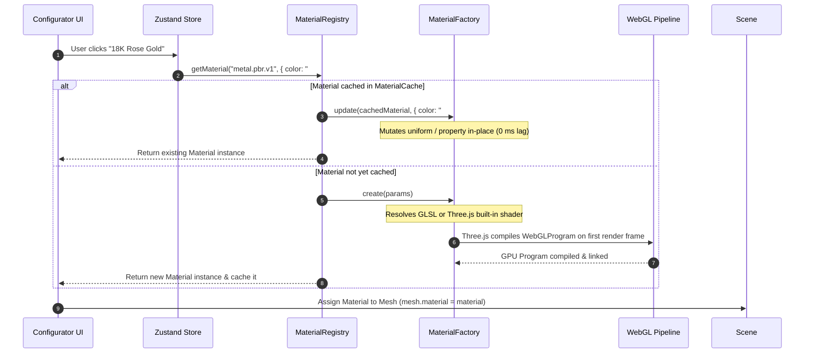

# 03 - Shader and Material Architecture Specification

## 1. Executive Summary

This document specifies the shader and material architecture for the standalone 3D jewellery configurator.

In contrast to the legacy implementation—which scattered `.material.color` mutations across raw DOM click handlers and locked diamond optics inside a closed-source vendor bundle—this architecture introduces:
1. **Physical File Separation**: Dedicated version-controlled GLSL files residing exclusively in `renderer/shaders/`.
2. **Typed Material Registry**: A central registry mapping stable string IDs (e.g. `metal.pbr.v1`, `diamond.refraction.v1`, `diamond.custom.v1`) to concrete material factories.
3. **Deterministic Compilation & Caching**: GPU shader programs compile once, are cached in memory, and update uniform values dynamically during customer interaction without scene graph reconstruction.
4. **Zero-Trust Security**: No raw executable GLSL is accepted over APIs or stored in product database fields. All shaders are static, audited, and deployed as frontend assets.

---

## 2. Directory Layout & Source Code Organization

Shader source files and material factories are grouped strictly by rendering responsibility:

```text
apps/configurator/src/renderer/
├── materials/
│   ├── registry.ts                     # Central typed registry & factory dispatcher
│   ├── diamonds/
│   │   ├── RefractionDiamondMaterial.ts# Drei MeshRefractionMaterial wrapper (diamond.refraction.v1)
│   │   └── CustomDiamondMaterial.ts    # Custom GLSL ShaderMaterial wrapper (diamond.custom.v1)
│   ├── metals/
│   │   └── PbrMetalMaterial.ts         # Three.js MeshStandardMaterial wrapper (metal.pbr.v1)
│   └── types.ts                        # MaterialFactory, MaterialParameters interfaces
└── shaders/
    ├── diamond/
    │   ├── refraction.vert.glsl        # Custom diamond vertex shader
    │   ├── refraction.frag.glsl        # Custom diamond raymarching & dispersion fragment shader
    │   ├── normal-capture.vert.glsl    # Internal facet normal bake vertex shader
    │   └── normal-capture.frag.glsl    # Internal facet normal bake fragment shader
    └── custom/
        └── README.md                   # Guidelines for adding experimental shaders
```

---

## 3. Shader Material Registry & Stable Material IDs

The `MaterialRegistry` maps string identifiers to typed material factories. UI components interact only with material IDs and parameters, never touching WebGL shaders directly.

### Registered Material Identifiers:

```typescript
export type MaterialId = 
  | 'metal.pbr.v1'           // Standard Three.js PBR precious metal factory
  | 'diamond.refraction.v1'   // Production Drei <MeshRefractionMaterial> factory
  | 'diamond.custom.v1';     // Advanced custom GLSL facet-raymarching factory
```

### Registry Definition (`renderer/materials/registry.ts`):

```typescript
import { Material, Color } from 'three';
import { PbrMetalMaterialFactory } from './metals/PbrMetalMaterial';
import { RefractionDiamondMaterialFactory } from './diamonds/RefractionDiamondMaterial';
import { CustomDiamondMaterialFactory } from './diamonds/CustomDiamondMaterial';

export interface MaterialFactory<TParams> {
    id: MaterialId;
    family: 'metal' | 'gemstone';
    create(params: TParams): Material;
    update(material: Material, params: Partial<TParams>): void;
    dispose(material: Material): void;
}

export class MaterialRegistry {
    private static factories: Map<MaterialId, MaterialFactory<any>> = new Map();
    private static materialCache: Map<string, Material> = new Map();

    static register<TParams>(factory: MaterialFactory<TParams>) {
        this.factories.set(factory.id, factory);
    }

    static getMaterial<TParams>(id: MaterialId, params: TParams, cacheKey?: string): Material {
        if (cacheKey && this.materialCache.has(cacheKey)) {
            const mat = this.materialCache.get(cacheKey)!;
            const factory = this.factories.get(id);
            if (factory) factory.update(mat, params);
            return mat;
        }

        const factory = this.factories.get(id);
        if (!factory) throw new Error(`Material factory ${id} is not registered.`);
        const mat = factory.create(params);
        if (cacheKey) this.materialCache.set(cacheKey, mat);
        return mat;
    }

    static clearCache() {
        this.materialCache.forEach(mat => mat.dispose());
        this.materialCache.clear();
    }
}

// Self-register built-in factories on module load
MaterialRegistry.register(new PbrMetalMaterialFactory());
MaterialRegistry.register(new RefractionDiamondMaterialFactory());
MaterialRegistry.register(new CustomDiamondMaterialFactory());
```

---

## 4. Gemstone Material Architecture (`diamond.refraction.v1`)

The production gemstone implementation wraps `@react-three/drei`'s `<MeshRefractionMaterial>`, providing high visual fidelity with zero vendor lock-in.

### Parameter Schema:
```typescript
export interface DiamondMaterialParameters {
    ior: number;              // Index of refraction (default: 2.42 for diamond, 1.77 for sapphire)
    dispersion: number;       // Chromatic aberration delta (default: 0.015)
    bounces: number;          // Internal reflection bounces (default: 3 to 5)
    fresnel: number;          // Surface reflection coefficient (default: 0.17)
    color: string | Color;    // Body color tint (#FFFFFF for white diamond, #F70DB1 for ruby)
    absorption: number;       // Beer-Lambert light attenuation along internal ray paths
    envMapIntensity: number;  // Environment reflection scale (default: 1.0)
    fastChroma: boolean;      // Performance toggle for mobile (reduces dispersion samples)
}
```

### Optical Capabilities:
- **Snell's Law Refraction**: Accurately calculates light deflection upon entering the crown facets.
- **Total Internal Reflection**: Traps light inside the pavilion until it exits upward through the table.
- **Three-Wavelength Dispersion**: Evaluates red, green, and blue ray paths at distinct indices, producing natural diamond "fire".

---

## 5. Precious Metal Material Architecture (`metal.pbr.v1`)

Precious metals use Three.js's built-in `MeshStandardMaterial` / `MeshPhysicalMaterial`, combining high performance with accurate physical response.

### Metal Presets & Calibration Matrix:

| Preset ID | Metal Type | Hex Color | Metalness | Roughness | Finish Style | Optical Notes |
|---|---|---|---|---|---|---|
| `18K_YELLOW_POLISHED` | 18K Yellow Gold | `#E2BF7F` | `1.0` | `0.02` | High Polish | Warm golden tint; sharp specular softbox reflections |
| `18K_WHITE_POLISHED`  | 18K White Gold  | `#F4F4F6` | `0.92`| `0.04` | High Polish | Slight rhodium luster; high reflectivity |
| `18K_ROSE_POLISHED`   | 18K Rose Gold   | `#E8A399` | `1.0` | `0.03` | High Polish | High copper alloy content; warm pink-gold hue |
| `PLATINUM_POLISHED`   | 950 Platinum    | `#E5E5E8` | `0.95`| `0.02` | High Polish | Cool, bright silver-white; higher density weight in pricing |
| `18K_YELLOW_SATIN`    | 18K Yellow Gold | `#DFBA76` | `0.90`| `0.28` | Satin Brushed | Brushed micro-grooves; diffuse specular sheen |
| `18K_ROSE_SATIN`      | 18K Rose Gold   | `#E59F94` | `0.90`| `0.28` | Satin Brushed | Matte luxury finish; broad highlight spread |

---

## 6. Shader Compilation, Loading, and Caching Lifecycle



### Vite Shader Bundling Configuration:
Vite loads raw GLSL files at build time without requiring external loaders via the `?raw` suffix:
```typescript
import refractionVert from '../shaders/diamond/refraction.vert.glsl?raw';
import refractionFrag from '../shaders/diamond/refraction.frag.glsl?raw';

export const customDiamondShader = {
    vertexShader: refractionVert,
    fragmentShader: refractionFrag,
    uniforms: { ... }
};
```
This guarantees that all shader source code is validated by TypeScript during the build step and bundled into the static application bundle, eliminating runtime network fetches for shader code.
