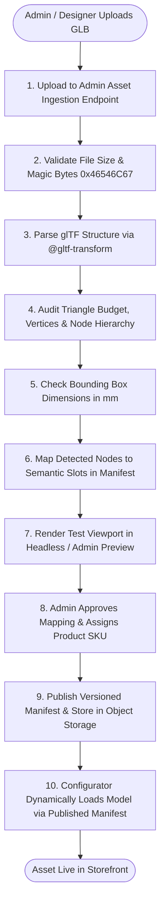

# 04 - 3D GLB Asset Pipeline and Ingestion Standards

## 1. Executive Summary

This specification establishes the asset pipeline for authoring, validating, ingesting, and registering 3D jewellery models into the configurator.

In the legacy Crystal Jewels application, ring models were hardcoded in procedural logic (`ring_webgi.glb` and `ring2_webgi.glb`), relying on fragile scene node names. This pipeline establishes a **manifest-driven asset mapping system** that allows 3D artists, designers, and administrators to register new ring models without altering a single line of frontend renderer code.

---

## 2. 3D Model Authoring Standards

To guarantee optical realism and seamless material assignment, all 3D CAD files exported from Blender, Rhino/MatrixGold, or 3ds Max must conform to strict specifications:

### 2.1 Scale and Orientation
- **Unit System**: Metric. The base unit must be **millimeters ($1.0 \text{ unit} = 1.0 \text{ mm}$)**.
  - A size 6.5 ring must have an internal shank diameter of $\approx 16.9 \text{ mm}$.
  - A 1.0-carat round brilliant diamond must have a table-to-culet depth of $\approx 3.9 \text{ mm}$ and a girdle diameter of $\approx 6.5 \text{ mm}$.
- **Coordinate System**: Right-handed, $Y$-Up ($Z$ towards camera, $X$ right).
- **Origin ($0, 0, 0$)**: Centered precisely at the ring shank's geometric center (the center of the finger hole).

### 2.2 Geometry & Facet Integrity
- **Manifold Mesh**: All gemstones must be strictly manifold (watertight, closed volumes) with zero non-manifold edges, flipped normals, or internal self-intersecting faces.
- **Authentic Gemstone Facets**: Gemstones must not be smoothed or shaded with averaged normals. Each facet plane must have flat shading or co-planar vertex normals so that the refractive shader reflects sharp, distinct flashes.
- **Budget Limits**:
  - Maximum total triangles per ring: **150,000 triangles**.
  - Maximum total vertices per ring: **100,000 vertices**.
  - Center diamond budget: **300 to 2,000 triangles** (depending on cut complexity).
  - Pavé stones: Reusable shared mesh references across multiple nodes or hardware instancing.

---

## 3. Semantic Component Mapping Manifest

Rather than forcing artists to rename their internal Blender objects to rigid strings, the configurator uses a **Component Mapping Manifest**. This manifest maps arbitrary node names in the GLB to standardized semantic component slots.

### Standard Component Slots:

| Semantic Slot | Expected Geometry | Assigned Material Family | Customization Options |
|---|---|---|---|
| **`Shank`** | The finger band | `metal.pbr.v1` | Metal type (Yellow, White, Rose Gold, Platinum) & finish |
| **`Setting`** | The basket / gallery under the stone | `metal.pbr.v1` | Two-tone metal selection |
| **`Prongs`** | Metal claws holding the center stone | `metal.pbr.v1` | Metal selection; morph-target scaling with carat weight |
| **`CenterStone`** | Primary focal gemstone | `diamond.refraction.v1` | Shape, Carat weight, Color tint, IOR, Dispersion |
| **`SideStones`** | Accent diamonds / halo stones | `diamond.refraction.v1` | Matched stone color tint |
| **`PaveStones`** | Band micro-pavé diamonds | `diamond.refraction.v1` | Micro-pavé sparkle |

### Sample Mapping Manifest (`solitaire-cathedral-manifest.json`):

```json
{
  "$schema": "https://schema.yourstore.com/manifest-v1.json",
  "modelId": "solitaire_cathedral_01",
  "version": "1.0.0",
  "assetUrl": "/models/rings/solitaire_cathedral_01.glb",
  "checksum": "sha256-a1b2c3d4e5f6...",
  "componentMappings": {
    "Shank": {
      "nodeName": "Mesh_Band_Cathedral",
      "defaultMaterialId": "metal.pbr.v1",
      "defaultPreset": "18K_ROSE_POLISHED"
    },
    "Setting": {
      "nodeName": "Mesh_Basket_Base",
      "defaultMaterialId": "metal.pbr.v1",
      "defaultPreset": "PLATINUM_POLISHED"
    },
    "Prongs": {
      "nodeName": "Mesh_Prongs_SixClaw",
      "defaultMaterialId": "metal.pbr.v1",
      "defaultPreset": "PLATINUM_POLISHED",
      "morphTargets": {
        "caratScale": "Carat_1ct_to_3ct"
      }
    },
    "CenterStone": {
      "nodeName": "Gem_Center_RoundBrilliant",
      "defaultMaterialId": "diamond.refraction.v1",
      "defaultPreset": "DIAMOND_WHITE_EXCELLENT",
      "caratWeight": 1.5,
      "cutShape": "ROUND"
    }
  }
}
```

---

## 4. The 10-Step Asset Ingestion & Validation Workflow



### Detailed Validation Criteria (Step 4 & 5):
- **Security Check**: The binary GLB must contain zero executable scripts, external HTTP texture URIs, or untrusted vendor extensions. All buffers must reside internally within glTF binary chunks.
- **Resource Constraints**: Total file size must not exceed **25 MB** before compression.
- **Bounding Box Validation**: The model dimensions must fit within realistic jewellery bounds ($10\text{ mm} \le \text{Diameter} \le 35\text{ mm}$). Assets exported in meters ($15\text{ meters}$) are rejected with an explicit error explaining the scale mismatch.

---

## 5. Storage Architecture

```
[Local Development]
├── Persistent Docker Volume: ./data/storage/models/
└── Static Development Server: http://localhost:8080/storage/

[Production Environment]
├── S3-Compatible Object Storage (AWS S3 / Cloudflare R2 / MinIO)
│   ├── /models/rings/{modelId}/{version}/model.glb
│   ├── /models/manifests/{modelId}/{version}/manifest.json
│   └── /previews/{modelId}/thumbnail.webp
└── CloudFront / CDN Edge Caching (1-year immutable cache header)
```

- **Database Separation**: Binary `.glb` files are never stored inside relational database tables. PostgreSQL / Medusa stores only the asset URL, SHA-256 checksum, component mapping JSON, and version metadata.
