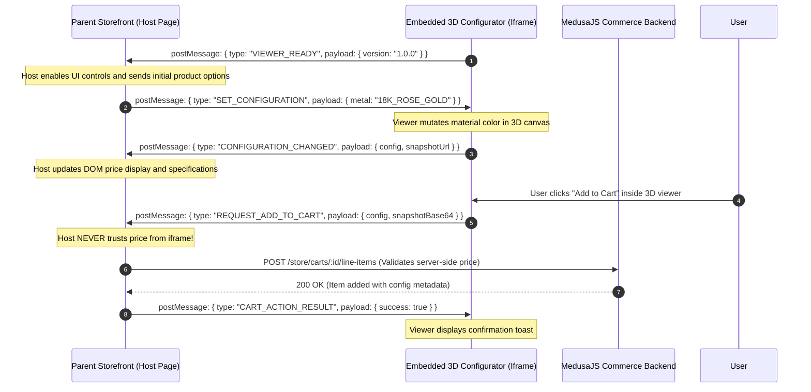

# 07 - Storefront Embedding and Iframe Integration Guide

## 1. Executive Summary

This guide specifies how e-commerce storefronts (built with Next.js, Remix, Shopify Hydrogen, or standard HTML) integrate the 3D jewellery configurator.

The viewer supports two official deployment modes:
1. **Mode A: Direct Link (Full-Screen Experience)**: The customer navigates directly to `/configure/:productSlug`, opening a dedicated, immersive full-viewport configurator.
2. **Mode B: Embedded Iframe (Product Detail Page)**: The configurator is embedded directly inside an existing PDP tab or modal, communicating bidirectionally with the host storefront via a typed, secure `postMessage` protocol.

---

## 2. Mode A: Direct Link Integration

In Direct Link mode, the configurator runs as a standalone web application hosted on its own subdomain or sub-path:
`https://viewer.yourjewellery.com/configure/the-eternal-solitaire?metal=18K_ROSE_GOLD&carat=1.5`

### Query Parameter Synchronization:
The direct viewer parses incoming URL search parameters to pre-populate selections:
- `?metal=18K_ROSE_GOLD`
- `?finish=HIGH_POLISH`
- `?stone=OVAL`
- `?carat=1.5`
- `?size=6.5`
- `?cfg=cfg_9a8b7c6d5e4f` (Restores a saved configuration from the backend)

---

## 3. Mode B: Embedded Iframe Integration

In Embedded mode, the host product detail page renders an `<iframe>` container.

```html
<!-- Host Storefront Product Detail Page -->
<div class="product-configurator-container" style="width: 100%; height: 650px; position: relative;">
  <iframe
    id="jewel-viewer-frame"
    src="https://viewer.yourjewellery.com/configure/the-eternal-solitaire?embed=true"
    style="width: 100%; height: 100%; border: none;"
    allow="accelerometer; camera; gyroscope; web-share"
    sandbox="allow-scripts allow-same-origin allow-forms allow-popups"
    title="3D Ring Configurator"
  ></iframe>
</div>
```

---

## 4. Secure Bi-Directional `postMessage` Protocol

Cross-origin `window.postMessage` communication enforces strict origin validation and typed message schemas.



---

## 5. Event Message Schemas (`@configurator/contracts`)

### 5.1 Outgoing Events (Iframe $\to$ Host):

#### `VIEWER_READY`
Dispatched when the WebGL context is initialized, the GLB asset is mounted, and the 3D canvas is interactive.
```typescript
interface ViewerReadyMessage {
  type: 'VIEWER_READY';
  payload: {
    productId: string;
    modelId: string;
    capabilities: {
      webgl2: boolean;
      instancing: boolean;
      highDpi: boolean;
    };
  };
}
```

#### `CONFIGURATION_CHANGED`
Dispatched whenever the customer alters a metal, gemstone, carat size, or engraving.
```typescript
interface ConfigurationChangedMessage {
  type: 'CONFIGURATION_CHANGED';
  payload: {
    configuration: RingConfiguration;
    estimatedPriceUSD: number;
    previewThumbnailUrl?: string;
  };
}
```

#### `REQUEST_ADD_TO_CART`
Dispatched when the customer clicks the primary action button inside the configurator.
```typescript
interface RequestAddToCartMessage {
  type: 'REQUEST_ADD_TO_CART';
  payload: {
    configuration: RingConfiguration;
    snapshotDataUrl: string; // JPEG data URL for cart preview
  };
}
```

---

### 5.2 Incoming Events (Host $\to$ Iframe):

#### `SET_CONFIGURATION`
Commands the 3D viewer to apply an external selection (e.g. customer clicks a metal swatch in the parent PDP).
```typescript
interface SetConfigurationMessage {
  type: 'SET_CONFIGURATION';
  payload: Partial<RingConfiguration>;
}
```

#### `CART_ACTION_RESULT`
Informs the 3D viewer whether the backend cart operation succeeded or failed.
```typescript
interface CartActionResultMessage {
  type: 'CART_ACTION_RESULT';
  payload: {
    success: boolean;
    cartId?: string;
    errorMessage?: string;
  };
}
```

---

## 6. Security & Content Security Policy (CSP)

### 6.1 Origin Validation
Both the host storefront and the embedded configurator **must** validate `event.origin` on every received message:

```typescript
// Inside apps/configurator/src/messenger/IframeMessenger.ts
const ALLOWED_STOREFRONT_ORIGINS = [
  'https://www.yourjewellery.com',
  'https://staging.yourjewellery.com',
  'http://localhost:3000'
];

window.addEventListener('message', (event) => {
  if (!ALLOWED_STOREFRONT_ORIGINS.includes(event.origin)) {
    console.warn(`Untrusted message origin rejected: ${event.origin}`);
    return;
  }
  // Process typed message
});
```

### 6.2 Recommended CSP Headers:
```http
Content-Security-Policy: frame-ancestors 'self' https://www.yourjewellery.com https://staging.yourjewellery.com; default-src 'self'; script-src 'self'; style-src 'self' 'unsafe-inline'; img-src 'self' data: blob: https://storage.yourjewellery.com; connect-src 'self' https://api.yourjewellery.com;
```

> [!CAUTION]
> The host storefront must **never** accept client-submitted prices or variant discounts from the iframe. The parent application must extract only the validated option identifiers and re-verify authoritative prices against MedusaJS before finalizing checkout.
