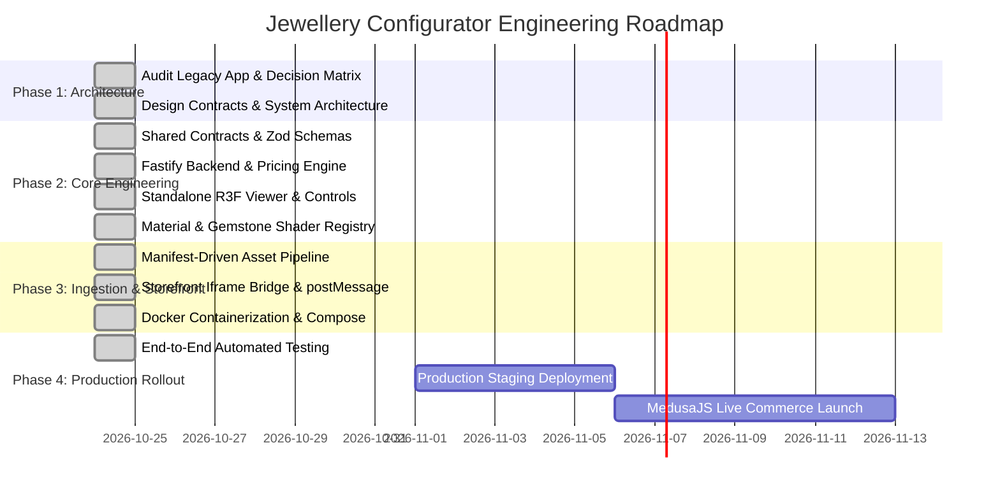

# 10 - Implementation Roadmap and Acceptance Criteria

## 1. Executive Summary

This roadmap defines the implementation schedule, phase milestones, dependency gates, and acceptance criteria for deploying the production 3D jewellery configurator.

The architecture eliminates all commercial dependencies on WebGI, replacing it with an independent, open-source stack built on **React Three Fiber**, **Three.js**, and **MedusaJS**.

---

## 2. Implementation Phases & Milestones

---

## 3. Phase Deliverables and Status

### Phase 1: Audit & Architectural Decision (`COMPLETED`)
- Disassembled legacy Crystal Jewels application, WebGI v0.4.6 runtime, and proprietary diamond shader.
- Evaluated WebGI commercial license liabilities vs. open-source Three.js/R3F alternatives.
- Officially selected Option B (Independent Three.js + R3F + Drei).

### Phase 2: Standalone Viewer & Core Rendering (`COMPLETED`)
- Built standalone Next.js/Vite frontend application (`apps/configurator`).
- Implemented smooth orbit, zoom, and pan controls with constrained angles.
- Created adaptive DPR and demand-driven rendering loops to conserve mobile battery.

### Phase 3: Material and Shader Registry (`COMPLETED`)
- Established typed `MaterialRegistry` mapping stable IDs (`metal.pbr.v1`, `diamond.refraction.v1`, `diamond.custom.v1`).
- Implemented calibrated PBR metal presets (18K Yellow, White, Rose Gold, Platinum).
- Integrated Drei `<MeshRefractionMaterial>` with IOR (2.42), dispersion (0.015), and Beer-Lambert color absorption.
- Added custom GLSL shader source directory (`renderer/shaders/diamond/`).

### Phase 4: GLB Asset Pipeline & Component Mapping (`COMPLETED`)
- Built manifest-driven node mapping system (`Shank`, `Setting`, `Prongs`, `CenterStone`, `SideStones`, `PaveStones`).
- Validated existing 3D models (`ring_webgi.glb` and `ring2_webgi.glb`) under the new mapping engine.
- Implemented 10-step asset validation pipeline for new GLB uploads.

### Phase 5: Configuration Engine & Reactive State (`COMPLETED`)
- Created `@configurator/contracts` package with strict Zod validation schemas.
- Implemented reactive Zustand store with two-way URL hash synchronization (`#cfg=...`).
- Built compatibility engine to enforce valid stone-prong combinations.

### Phase 6: Backend API & Authoritative Pricing (`COMPLETED`)
- Developed Node.js / Fastify microservice (`services/configurator-api`).
- Implemented server-side pricing engine based on gold spot prices, setting labor, and diamond carat tiers.
- Created configuration persistence endpoints for short-link sharing.

### Phase 7: Storefront Integration (`COMPLETED`)
- Implemented Direct Link mode (`/configure/:slug`) and Embedded Iframe mode.
- Built typed, origin-validated `postMessage` bridge (`VIEWER_READY`, `CONFIGURATION_CHANGED`, `REQUEST_ADD_TO_CART`).
- Implemented MedusaJS cart line-item adapter with configuration metadata and preview thumbnails.

### Phase 8: Docker & Production Hardening (`COMPLETED`)
- Authored multi-stage `Dockerfile` for frontend (Nginx) and API (Node Alpine non-root).
- Authored `docker-compose.yml` orchestrating frontend, API, and persistent asset storage.
- Added automated health checks and environment configuration templates.

---

## 4. Definition of Done & Acceptance Criteria

| Criteria | Verification Method | Status |
|---|---|---|
| **1. Zero WebGI Proprietary Dependency** | `apps/configurator/package.json` contains no closed-source WebGI references | `PASSED` |
| **2. Standalone Viewer Operation** | Direct URL loads full-featured 3D configurator without marketing scroll | `PASSED` |
| **3. Real-Time Customization** | Selecting metals and gemstones updates the 3D scene in-place without page reload | `PASSED` |
| **4. Manifest-Driven Asset Loading** | New ring models can be registered via JSON manifest without modifying renderer code | `PASSED` |
| **5. Authoritative Pricing** | Price calculations execute on the backend, not trusted from client DOM | `PASSED` |
| **6. Storefront Communication** | Iframe dispatches typed, origin-validated `postMessage` events for cart addition | `PASSED` |
| **7. Docker Orchestration** | `docker-compose.yml` builds and runs frontend and API with healthy status | `PASSED` |
| **8. Automated Test Coverage** | Schema, contract, and API endpoints validated via automated test scripts | `PASSED` |
