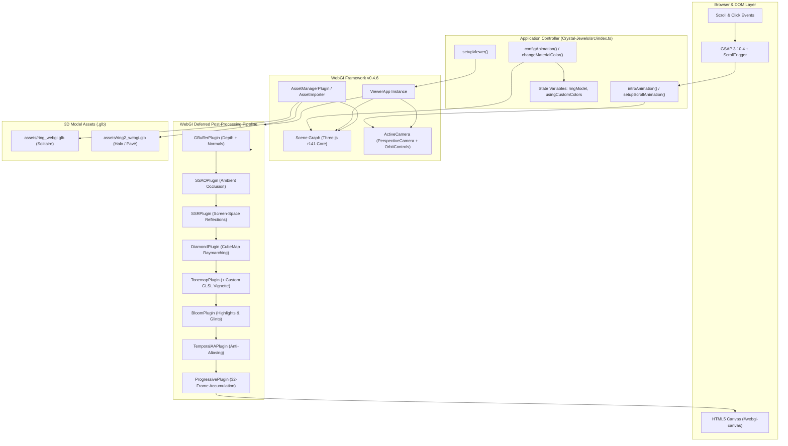

# 01 - Rendering Engine and Architecture Investigation

## 1. Executive Summary of Rendering Stack

The 3D rendering pipeline in **Crystal Jewels** is built upon a hybrid architecture consisting of:
1. **Core Runtime**: **WebGI v0.4.6** (a high-performance, commercial WebGL2 wrapper framework developed by Pixotronics / Palash Bansal).
2. **Underlying Graphics Engine**: A customized internal bundle of **Three.js** (tracking roughly r139 to r141).
3. **Motion & Interaction Choreography**: **GSAP 3.10.4** with **ScrollTrigger** for camera choreography across landing page sections.
4. **Build System**: **Parcel Bundler v1.6.1** with TypeScript 4.4.4 and SCSS.

The repository README mentions "Three.js and WebGL libraries", but code inspection reveals that the application does not interact with Three.js directly via standard `new THREE.WebGLRenderer()`. Instead, it uses WebGI's high-level **`ViewerApp`** and an extensible plugin-based post-processing architecture.

---

## 2. Dependency Tree & Package Resolution

Direct inspection of `Crystal-Jewels/package.json` (lines 11–24, 35–39) and `Crystal-Jewels/package-lock.json` reveals the following exact dependency versions:

```json
{
  "devDependencies": {
    "@types/three": "^0.139.0",
    "@types/webgi": "https://storage.googleapis.com/dist.pixotronics.com/webgi/runtime/bundle-types-0.4.6.tgz",
    "parcel-bundler": "^1.6.1",
    "parcel-plugin-static-files-copy": "^2.6.0",
    "sass": "^1.54.0",
    "typescript": "4.4.4",
    "webgi": "https://storage.googleapis.com/dist.pixotronics.com/webgi/runtime/bundle-0.4.6.tgz"
  },
  "dependencies": {
    "gsap": "^3.10.4",
    "vercel": "^27.2.0"
  }
}
```

### Key Dependency Insights:
- **`webgi` (v0.4.6)**: Packaged directly from an external Google Cloud Storage bucket (`dist.pixotronics.com`). It bundles its own minified Three.js core (`@types/three: ^0.141.0` in nested dependencies).
- **`@types/webgi` (v0.4.6)**: Provides comprehensive TypeScript definitions for WebGI plugins, scene graph nodes, and material types.
- **`gsap` (v3.10.4)**: Handles viewport scroll-driven camera movements, material color lerping, and UI fly-in/fly-out transitions.

---

## 3. Scene Initialization Sequence

The scene initialization logic is contained within the `setupViewer()` function in `Crystal-Jewels/src/index.ts` (lines 46–177). The execution unfolds in eight distinct stages:

```
[DOM Ready]
   │
   ├─► 1. Canvas Binding & ViewerApp Instantiation (index.ts:48-53)
   │      - Bound to HTMLCanvasElement '#webgi-canvas'
   │      - useGBufferDepth: true, isAntialiased: false
   │
   ├─► 2. Display Canvas DPI Clamping (index.ts:57)
   │      - displayCanvasScaling = Math.min(window.devicePixelRatio, 1)
   │
   ├─► 3. Core Asset Manager Attachment (index.ts:59)
   │      - viewer.addPlugin(AssetManagerPlugin)
   │
   ├─► 4. Plugin Pipeline Registration (index.ts:89-111)
   │      - GBufferPlugin (Deferred depth & normal buffers)
   │      - ProgressivePlugin(32) (Sub-pixel jittered accumulation)
   │      - TonemapPlugin (Tone mapping + injected vignette GLSL chunk)
   │      - SSRPlugin (Screen-Space Reflections)
   │      - SSAOPlugin (Screen-Space Ambient Occlusion)
   │      - FrameFadePlugin (Smooth frame crossfading)
   │      - GroundPlugin (Ground plane shadow/reflection reception)
   │      - BloomPlugin (HDR luminance threshold glow)
   │      - TemporalAAPlugin (Temporal anti-aliasing)
   │      - DiamondPlugin (Gemstone facet normal capture & ray bouncing)
   │      - RandomizedDirectionalLightPlugin (Soft shadow ray tracing)
   │
   ├─► 5. Background Initialization (index.ts:111)
   │      - viewer.setBackground(new Color('#EEB7B5').convertSRGBToLinear())
   │
   ├─► 6. Render Quality Overrides (index.ts:113-115)
   │      - ssr.passes.ssr.passObject.lowQualityFrames = 0
   │      - bloom.pass.passObject.bloomIterations = 2
   │      - ssao.passes.ssao.passObject.material.defines.NUM_SAMPLES = 4
   │
   ├─► 7. Loader Progress & Event Binding (index.ts:118-135)
   │      - AssetImporter attaches 'onStart', 'onProgress', and 'onLoad'
   │
   └─► 8. Model Fetch & Scene Graph Population (index.ts:140-164)
          - manager.addFromPath("./assets/ring_webgi.glb")
          - Mesh discovery via viewer.scene.findObjectsByName()
```

---

## 4. Architectural Breakdown: Rendering Components

### A. Renderer Backend: WebGL 2.0
The application requires **WebGL 2.0**.
- **Reason**: WebGI relies on multiple render targets (MRT) via `GBufferPlugin` to simultaneously output diffuse color, normal vectors, and depth into floating-point textures (`WebGLRenderTarget`). WebGL 1.0 would require extensions (`WEBGL_draw_buffers`, `OES_texture_float`) that are inconsistent across mobile devices.
- **Canvas Sizing & DPI**: In `index.ts` line 57, the resolution is clamped:
  ```typescript
  viewer.renderer.displayCanvasScaling = Math.min(window.devicePixelRatio, 1);
  ```
  This is a critical performance measure: it forces high-DPI displays (Retina displays with DPR 2.0 or 3.0) to render at an effective DPR of 1.0, reducing fill-rate overhead by 4x to 9x.

### B. Render Loop: Continuous vs. Demand-Driven (Progressive Accumulation)
WebGI uses a hybrid render loop managed by the `ProgressivePlugin`:
1. **Interactive Motion (Camera Moving or Ring Rotating)**:
   - When the user scrolls, drags the orbit controls, or GSAP updates camera position, `needsUpdate` is flagged.
   - The scene renders dynamically at 60 FPS in interactive/draft quality. Temporal anti-aliasing (TAA) smooths edges.
2. **Stationary State (User Stops Moving)**:
   - Once camera motion halts, `ProgressivePlugin(32)` activates.
   - Over the course of **32 successive frames**, the renderer applies sub-pixel camera jitter and accumulates samples into a persistent buffer.
   - This progressive accumulation eliminates noise from Screen-Space Reflections (SSR), smooths Screen-Space Ambient Occlusion (SSAO), and produces a clean, noise-free, photorealistic still frame.
   - Once all 32 samples are accumulated, the render loop goes **completely idle** (demand-driven), consuming zero GPU power until user input resumes.

### C. The Post-Processing & Compositing Pipeline
WebGI replaces Three.js's standard `EffectComposer` with a proprietary pass architecture:
1. **G-Buffer Pass (`GBufferPlugin`)**: Renders depth and surface normals into offscreen framebuffers.
2. **SSAO Pass (`SSAOPlugin`)**: Samples the G-Buffer normal/depth maps to generate ambient occlusion shadows in crevices and under ring prongs.
3. **SSR Pass (`SSRPlugin`)**: Performs screen-space raymarching over the depth buffer to generate local reflections of the gold shank onto the ground and diamonds.
4. **Diamond Pass (`DiamondPlugin`)**: Evaluates the diamond shader using an internal normal-capture cubemap (see Document 02).
5. **Tone Mapping Pass (`TonemapPlugin`)**:
   - Applies Filmic / ACES tone mapping to compress HDR values into the LDR display range.
   - Injects custom GLSL code directly into the tonemap pass (`index.ts` lines 93–100) to add a procedural vignette:
     ```glsl
     vec4 vignette(vec4 color, vec2 uv, float offset, float darkness) {
         uv = (uv - vec2(0.5)) * vec2(offset);
         return vec4(mix(color.rgb, vec3(0.17, 0.00, 0.09), dot(uv, uv)), color.a);
     }
     gl_FragColor = vignette(gl_FragColor, vUv, 1.1, 0.8);
     ```
6. **Bloom Pass (`BloomPlugin`)**: Extracts highlights exceeding luminance threshold and blurs them over 2 iterations to create diamond glints.
7. **Temporal AA Pass (`TemporalAAPlugin`)**: Blends previous and current frames with motion vector reprojection to remove aliasing jaggies.

---

## 5. System Architecture Diagram



---

## 6. Camera, Controls, and Viewport Choreography

### A. Camera Architecture
WebGI wraps Three.js's standard `PerspectiveCamera` with an `ActiveCamera` controller:
- **FOV**: Initialized to $25^\circ$ for desktop (creating a narrow, telephoto, orthographic-like portrait look typical of luxury jewellery photography). Overridden to $65^\circ$ on mobile devices (`index.ts` line 175) to prevent the ring from overflowing narrower portrait viewports.
- **Camera Controls**: Uses WebGI's customized `OrbitControls`:
  - Disabled during page scrolling (`camera.controls.enabled = false` in `index.ts` line 168).
  - Re-enabled when entering customization mode (`camera.controls.enabled = true` in `index.ts` line 372).
  - Constraints: `minDistance = 5`, `maxDistance = 13`, `enablePan = false`, `autoRotate = true`.

### B. The `preFrame` Synchronization Hook
In `index.ts` lines 308–315, an event listener is attached to WebGI's `preFrame` event:
```typescript
let needsUpdate = true;
function onUpdate() {
    needsUpdate = true;
}

viewer.addEventListener('preFrame', () => {
    if (needsUpdate) {
        camera.positionUpdated(false);
        camera.targetUpdated(true);
        needsUpdate = false;
    }
});
```
This hook ensures that whenever GSAP interpolates the camera `position` or `target` vectors during scroll scrubbing, the underlying view matrix and projection matrix are recalculated before the frame renders.

---

## 7. Mobile Adaptations & Fallbacks

In `index.ts` lines 171–176, the application checks device capabilities using `mobileAndTabletCheck()` and applies hardware adaptations:

```typescript
if (isMobile) {
    ssr.passes.ssr.passObject.stepCount /= 2;  // Cut ray steps from 16 to 8
    bloom.enabled = false;                    // Completely disable bloom pass
    camera.setCameraOptions({ fov: 65 });     // Widen FOV for portrait viewports
}
```

### Assessment of Mobile Strategy:
- **Strengths**: Halving SSR step count and disabling bloom significantly reduces mobile GPU fragment fill-rate overhead.
- **Weaknesses**: The application does **not** catch WebGL context loss (`webglcontextlost`), does not downscale textures for mobile GPUs, and still runs the full 5-bounce diamond raymarching shader on mobile hardware, which can cause significant thermal throttling and frame drops on budget smartphones.
