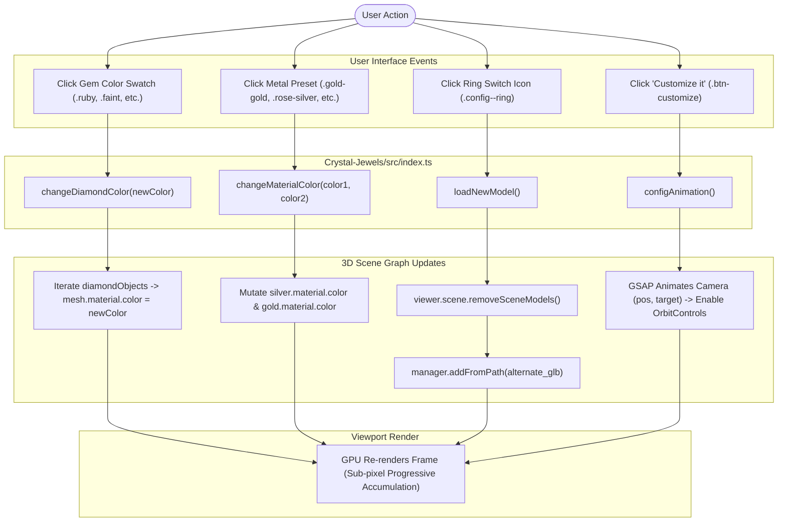

# 05 - Customization Flow and Interaction Tracing

## 1. Executive Summary: The Customization Engine

Customization in Crystal Jewels operates through direct, imperative DOM event listeners in `Crystal-Jewels/src/index.ts` that trigger in-place mutations of Three.js mesh material properties, or trigger complete scene wipes and reloads when switching ring models.

The application contains **zero parametric CAD capabilities** and **zero procedural geometry algorithms**. All customizations are purely visual surface modifications applied to static, pre-authored 3D assets.

---

## 2. Feature Implementation Matrix

| Customization Feature | Supported? | Implementation Mechanism | 3D Scene Action | State Variable Updated |
|---|---|---|---|---|
| **Center Stone Color** | **YES** | Click on color swatch (`.colors--list li`) | In-place mutation: `diamond.material.color = _gemColor` | `usingCustomColors = true` |
| **Metal Colors** | **YES** | Click on metal preset (`.materials--list li`) | In-place mutation: `silver.material.color = _c1; gold.material.color = _c2;` | `usingCustomColors = true` |
| **Ring Model Toggle** | **YES** | Click on ring icon (`.config--ring`) | Complete scene wipe (`removeSceneModels()`) and network load of alternate GLB | `ringModel = 1` or `2` |
| **Interactive 3D Mode**| **YES** | Click "Customize it" button (`.btn-customize`) | GSAP camera zoom, lock scrolling, enable `OrbitControls`, display customization UI | Audio playback, CSS class toggles |
| **Night Mode** | **YES** | Click moon icon (`.night--mode`) | Changes background color to `#22052f` and toggles CSS filter on DOM headers | `nightMode = !nightMode` |
| **Audio Loop** | **YES** | Click volume icon (`.music--control`) | Plays/pauses HTML5 `<Audio>` element (`assets/sounds/music_loop.mp3`) | `musicPlay = !musicPlay` |
| **Center Stone Shape** | **NO** | *Feature Absent* | None | None |
| **Carat Weight / Scale**| **NO** | *Feature Absent* | None | None |
| **Band Profile / Style**| **NO** | *Feature Absent* | None | None |
| **Prong / Setting Style**| **NO** | *Feature Absent* | None | None |
| **Ring Finger Sizing** | **NO** | *Feature Absent* | None | None |
| **Custom Text Engraving**| **NO** | *Feature Absent* | None | None |
| **Pricing Calculation** | **NO** | *Feature Absent* | None | None |
| **Add to Cart / Save** | **NO** | *Feature Absent* | None | None |

---

## 3. End-to-End Interaction Tracing

### Feature A: Gemstone Color Customization
1. **Trigger**: User clicks a color icon in `.gem--menu` (e.g., `<li class="ruby">`).
2. **Event Handler** (`index.ts` lines 474–478):
   ```typescript
   document.querySelector('.ruby')?.addEventListener('click', () => {
       changeDiamondColor(new Color('#f70db1'));
       document.querySelector('.colors--list li.active')?.classList.remove('active');
       document.querySelector('.ruby')?.classList.add('active');
   });
   ```
3. **Execution Function** (`index.ts` lines 532–537):
   ```typescript
   function changeDiamondColor(_gemColor: Color) {
       for (const o of diamondObjects) {
           o.material.color = _gemColor;
       }
       usingCustomColors = true;
   }
   ```
4. **Scene Impact**:
   - For Ring 1: Mutates `.material.color` across the 6 diamond meshes (`diamonds`, `diamonds001`..`005`).
   - For Ring 2: Mutates `.material.color` only on mesh `'Object'` (the center stone).
   - In both cases, `DiamondMaterial` receives the new color uniform; the fragment shader's Beer-Lambert absorption (`exp(-r * (1.0 - color))`) immediately tints the interior ray bounces to the new color.
5. **Latency**: Instantaneous (sub-millisecond single uniform update; zero shader recompilation).

---

### Feature B: Metal Preset Customization
1. **Trigger**: User clicks a metal finish preset in `.materials--menu` (e.g., `<li class="rose-silver">`).
2. **Event Handler** (`index.ts` lines 576–580):
   ```typescript
   document.querySelector('.rose-silver')?.addEventListener('click', () => {
       changeMaterialColor(new Color(0xfa8787), new Color(0xffffff));
       document.querySelector('.materials--list li.active')?.classList.remove('active');
       document.querySelector('.rose-silver')?.classList.add('active');
   });
   ```
3. **Execution Function** (`index.ts` lines 593–597):
   ```typescript
   function changeMaterialColor(_firstColor: Color, _secondColoor: Color) {
       silver.material.color = _firstColor;
       gold.material.color = _secondColoor;
       usingCustomColors = true;
   }
   ```
4. **Scene Impact**: The PBR material instances for `silver` (prongs/setting) and `gold` (shank) have their `.color` properties updated in-place.
5. **Latency**: Instantaneous (0 ms lag).

---

### Feature C: Ring Model Toggle
1. **Trigger**: User clicks the ring icon in the footer menu (`.config--ring`).
2. **Event Handler** (`index.ts` lines 621–630):
   ```typescript
   configRing.addEventListener('click', () => {
       gsap.to('.loader', { x: '0%', duration: 0.8, ease: "power4.inOut", onComplete: () => {
           loadNewModel();
       }});
   });
   ```
3. **Execution Function** (`index.ts` lines 632–690):
   ```typescript
   async function loadNewModel() {
       if (ringModel == 1) {
           viewer.scene.removeSceneModels(); // 1. Deletes entire 3D model from scene graph
           await manager.addFromPath("./assets/ring2_webgi.glb"); // 2. Fetches and parses alternate GLB
           gsap.to('.loader', { x: '100%', duration: 0.8, ease: "power4.inOut", delay: 1 });

           // 3. Re-discovers scene nodes by string matching
           ring = viewer.scene.findObjectsByName('Scene_1')[0];
           silver = viewer.scene.findObjectsByName('alliance')[0];
           gold = viewer.scene.findObjectsByName('entourage')[0];
           
           diamondObjects.length = 0;
           for (const obj of diamondsObjectNames2) {
               diamondObjects.push(viewer.scene.findObjectsByName(obj)[0]);
           }
           ringModel = 2;
           // 4. Reconfigures OrbitControls limits
       } else {
           // Mirrors logic in reverse to restore ring_webgi.glb
           ringModel = 1;
       }
   }
   ```
4. **Scene Impact & State Loss**:
   - Calling `removeSceneModels()` destroys all existing meshes and materials.
   - Any previously selected gemstone or metal colors are **completely wiped out** and reset to the glTF defaults.
5. **Latency**: Highly asynchronous (1.5 to 3.0 seconds depending on network latency and Draco decompression).

---

## 4. Object Resolution Strategy: The Hardcoded Name Risk

A critical architectural flaw in Crystal Jewels is how the application resolves 3D objects in the scene graph:

```typescript
// Crystal-Jewels/src/index.ts (lines 148-154)
ring = viewer.scene.findObjectsByName('Scene')[0];
silver = viewer.scene.findObjectsByName('silver')[0];
gold = viewer.scene.findObjectsByName('gold')[0];
for (const obj of diamondsObjectNames) {
    diamondObjects.push(viewer.scene.findObjectsByName(obj)[0]);
}
```

### Fragility Analysis:
1. **Hardcoded String Matching**: The application relies on exact string matches (`'Scene'`, `'silver'`, `'gold'`, `'alliance'`, `'entourage'`, `'diamonds'`).
2. **Zero Schema Validation**: If a 3D artist renames a node in Blender (e.g. from `silver` to `prong_setting`), `viewer.scene.findObjectsByName('silver')[0]` returns `undefined`. Attempting to read `silver.material.color` throws an unhandled runtime `TypeError: Cannot read properties of undefined (reading 'material')`, crashing all customization buttons.
3. **Index Fragility**: Taking `[0]` of the result assumes there is never duplicate naming in the asset hierarchy.

---

## 5. Customization Flow Diagram


