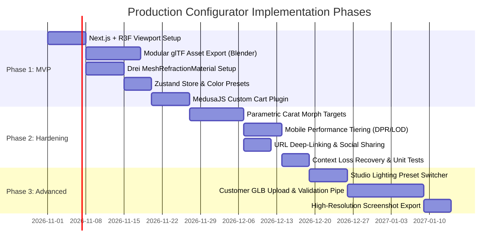

# 08 - Our Configurator Architecture and Implementation Options

## 1. Executive Summary & Design Goals

Our objective is to design an original, production-ready 3D diamond ring configurator for a high-end jewellery e-commerce storefront.

### Core User Requirements:
- Inspect a photorealistic 3D ring with smooth orbit, pan, and zoom controls.
- Seamlessly configure band styles, metal types (18K Yellow Gold, White Gold, Rose Gold, Platinum), center stone cuts (Round, Oval, Emerald, Pear, Cushion, Princess), and carat weights (0.5ct to 3.0ct).
- Real-time dynamic pricing tied authoritatively to an e-commerce backend (**MedusaJS**).
- Zero visual glitches, sub-2-second initial load, 60 FPS on desktop, and graceful fallbacks on mobile.
- Save, share (URL deep-linking), and add to cart functionality.
- Optional future support for custom customer GLB uploads.

---

## 2. Technology Stack Evaluation

```
+───────────────────────────────────────────────────────────────────────────────────────────────+
|                                  RECOMMENDED PRODUCTION STACK                                 |
+───────────────────────────────────────────────────────────────────────────────────────────────+
|                                                                                               |
|  [ Storefront Frontend ]                                                                      |
|  Next.js 14+ (App Router) + Tailwind CSS + Radix UI / Shadcn UI                              |
|                                                                                               |
|  [ 3D Scene Architecture ]                                                                    |
|  React Three Fiber (R3F) v8 + @react-three/drei + Three.js r160+                             |
|  - Declarative scene graph, automated resource disposal, reactive props                      |
|                                                                                               |
|  [ Optical Gemstone Shader ]                                                                  |
|  @react-three/drei <MeshRefractionMaterial> (by N8Programs)                                  |
|  - Real-time internal facet raymarching, chromatic dispersion, fast mobile performance        |
|                                                                                               |
|  [ Reactive State & Validation ]                                                              |
|  Zustand Store + Zod Schema Validation + URL SearchParams synchronization                     |
|                                                                                               |
|  [ Headless E-Commerce Backend ]                                                              |
|  MedusaJS v2 (Node.js Headless Commerce Core)                                                 |
|  - Custom Ring Pricing Plugin, Cart Line Items with Configuration JSON, Metal Spot Price API  |
|                                                                                               |
+───────────────────────────────────────────────────────────────────────────────────────────────+
```

### Detailed Stack Comparison:

| Evaluation Dimension | WebGI (Reference App) | Vanilla Three.js | React Three Fiber (R3F) + Drei (Recommended) |
|---|---|---|---|
| **Licensing & Ownership** | Proprietary commercial license; closed source; external bucket dependency | MIT (Full open-source ownership) | MIT (Full open-source ownership) |
| **Component Architecture** | Procedural script; DOM query manipulation | Imperative object creation; manual render loop | Declarative React components; reactive state binding |
| **Memory Management** | Manual disposal prone to VRAM leaks | Manual traversal (`geometry.dispose()`) | Automatic garbage collection on component unmount |
| **E-Commerce Ecosystem** | None (Isolated 3D demo) | Custom integration required | Native React integration with Next.js, Medusa, and Shopify |
| **Community & Documentation** | Limited commercial docs | Massive global community | Leading standard for modern web 3D |

---

## 3. Diamond Optical Rendering Strategy Comparison

We evaluated four distinct rendering approaches for our diamond configurator:

| Strategy | Visual Fidelity | GPU Cost / FPS | Mobile Support | Implementation Difficulty | Maintenance Burden |
|---|---|---|---|---|---|
| **1. Standard Three.js `MeshPhysicalMaterial`** | Moderate (Looks like high-index glass; no facet sparkle) | Very Low (60 FPS on all phones) | Excellent | Very Low (Built into Three.js) | Minimal |
| **2. Drei `<MeshRefractionMaterial>`** *(Recommended)* | **Very High** (Authentic facet raymarching, dispersion, TIR) | Moderate (60 FPS desktop, 45-60 FPS mobile) | Excellent | Low to Medium (npm package available) | Low |
| **3. Custom GLSL CubeMap Raymarching** *(WebGI Port)* | **Maximum Raster Realism** | High (Heavy fragment fill rate) | Moderate (Requires WebGL 2 float MRT) | Very High (Custom WebGL shader engineering) | High |
| **4. Real-Time GPU Path Tracing** (`three-gpu-pathtracer`) | **Unmatched Photorealism** (True caustics & physics) | Very High (Progressive accumulation only; noisy on move) | Poor on mobile | High | Moderate |

### Recommendation: Drei `<MeshRefractionMaterial>`
For a commercial storefront, **Strategy 2 (`<MeshRefractionMaterial>`)** provides the optimal balance. It delivers 90% of WebGI's optical quality with authentic internal dispersion and facet flashes, but is open-source, runs within React Three Fiber, and avoids the heavy G-Buffer overhead of WebGI.

---

## 4. 3D Asset Pipeline: Modular CAD vs. Monolithic GLB

### The Flaw of the Reference Implementation:
Crystal Jewels stores entire rings as monolithic, pre-assembled `.glb` files. Adding a new diamond cut requires modeling, texturing, and exporting an entirely new 1 MB file for every combination ($5 \text{ cuts} \times 4 \text{ band styles} = 20 \text{ files} = 20 \text{ MB}$).

### Recommended Modular Architecture:
Decompose the 3D ring into independent, swappable components that assemble dynamically at runtime:

```
[Ring Assembly Scene Graph]
   ├── [Shank Component]   (e.g., /assets/shanks/cathedral_shank.glb - 120 KB)
   ├── [Head Component]    (e.g., /assets/heads/six_prong_head.glb   - 65 KB)
   └── [Stone Component]   (e.g., /assets/stones/oval_brilliant.glb   - 80 KB)
```

### Parametric Ring Sizing & Carat Scaling:
- **Diamond Carat Scaling**: Scaling a diamond by carat weight follows volumetric scaling laws:
  $$ScaleFactor = \sqrt[3]{\frac{\text{Target Carat}}{\text{Base Carat}}}$$
  When a 1.0ct diamond ($6.5\text{ mm}$ diameter) is scaled to 2.0ct ($8.1\text{ mm}$ diameter), the head prongs must automatically scale and flare outward.
- **Parametric Head Adjustment**: Authorship in Blender using **Shape Keys (Morph Targets)** allows the prongs to smoothly flare outward from 0.5ct to 3.0ct without re-exporting distinct models.
- **Finger Ring Sizing**: Band diameter scales radially ($X/Z$) according to standard US ring size millimeter charts while preserving wall thickness via morph targets.

---

## 5. Feasibility of Customer Custom GLB Uploads

The user requested an investigation into whether customers could upload their own GLB models.

### Feasibility Verdict: `FEASIBLE WITH STRICT CONSTRAINTS, BUT HIGH RISK`

### Technical Challenges & Architecture Required:

```
[Customer Uploads GLB]
       │
       ▼
[Client-Side Pre-Validation]
       │ - File size check (< 25 MB)
       │ - Binary glTF header check (magic: 0x46546C67)
       ▼
[Server-Side WebAssembly Pipeline (@gltf-transform)]
       │ - Strip malicious extensions / scripts
       │ - Enforce triangle budget (< 100,000 triangles)
       │ - Check bounding box dimensions (ensure scale is in millimeters, not meters)
       │ - Semantic Node Classification (AI or heuristic mesh naming)
       ▼
[Material Remapping Engine]
       │ - Identify Gemstone mesh -> Assign <MeshRefractionMaterial>
       │ - Identify Band mesh     -> Assign PBR Precious Metal Material
       ▼
[Mount in 3D Configurator Viewport]
```

### Why Arbitrary Uploads are Difficult for E-Commerce:
1. **Scale Discrepancies**: 3D software exports in meters, centimeters, or inches. An uploaded ring might appear microscopic ($0.01\text{ mm}$) or as massive as a house ($10\text{ meters}$).
2. **Missing Facet Topology**: Customers uploading OBJ/STL exports from scan data have triangulated, messy surfaces lacking proper optical facet normals, rendering the diamond shader opaque or black.
3. **No CAD Pricing Link**: A custom uploaded mesh cannot be automatically priced because the system does not know the ring's gold volume, metal density, or diamond carat weight.

---

## 6. Implementation Roadmap



### Phase Summary:
- **Phase 1 (MVP - 4 Weeks)**: R3F viewer, modular shank/head/stone assets, `<MeshRefractionMaterial>`, studio HDRI, metal and stone color swatches, MedusaJS cart line-item integration.
- **Phase 2 (Production Hardening - 3 Weeks)**: Dynamic carat scaling, morph-target prong alignment, URL state serialization, mobile performance tuning, WebGL context loss recovery.
- **Phase 3 (Advanced Features - 4 Weeks)**: Dynamic lighting presets, ring engraving preview with custom 3D text extrusions, customer GLB upload pipeline.
